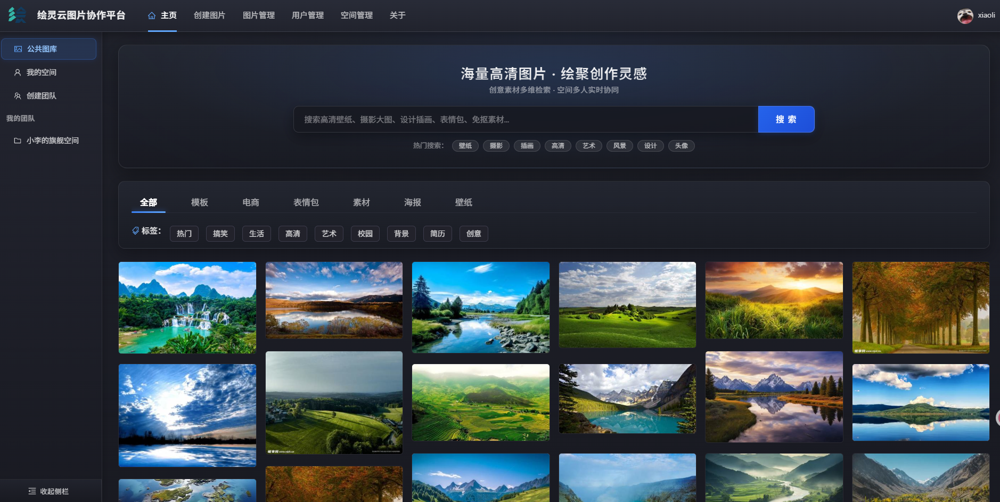
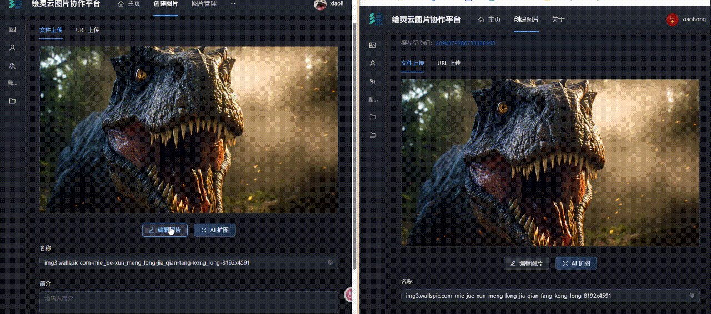

# ☁️ 绘灵云图片协作平台后端（DDD 架构版）

[](https://spring.io/projects/spring-boot)
[](https://www.oracle.com/java/)
[](https://baomidou.com/)
[](https://sa-token.com/)
[](https://lmax-exchange.github.io/disruptor/)
[](https://shardingsphere.apache.org/)

一款面向个人与企业团队的高性能、现代化云端图片管理与协同创作平台后端服务。本项目采用 **DDD（领域驱动设计，Domain-Driven Design）** 四层架构思想重构，结合 **WebSocket 协同同步**、**LMAX Disruptor 环形并发队列**、**ShardingSphere 动态分表**、**二级缓存** 与 **AI 图像扩展**，具备高并发、高内聚、易扩展的企业级生产规范。

---

## 📸 系统效果展示

### 1. 系统主页面与瀑布流画廊
支持基于颜色主色调、标签、分类的多维度检索，集成虚拟滚动与多端响应式瀑布流展示：


### 2. 多人实时协同编辑（团队空间）
支持团队空间内多协作者实时抢锁编辑、缩放/旋转动作毫秒级同步广播、状态全量回放与原子保存更新：


---

## 🌟 核心特色与技术亮点

### 1. 🏛️ DDD 领域驱动设计架构
工程打破传统三层 MVC 的贫血模型结构，按 DDD 战略与战术设计原则组织各领域边界：
- **用户接口层（Interfaces）**：极简薄控制器，专注于 HTTP 请求路由、参数映射、Swagger/Knife4j 展现与权限校验。
- **应用服务层（Application）**：负责跨聚合的业务用例编排（Use Case Orchestration），在领域事务提交完成后统筹外部通信、消息推送等副作用。
- **领域核心层（Domain）**：封装纯粹的业务实体（Entity）、值对象（Value Object）、聚合根与领域服务（Domain Service），维护核心商业逻辑与存储配额状态不变性。
- **基础设施层（Infrastructure）**：实现仓储接口（Repository Impl）、对象存储（腾讯云 COS）、AI 扩展接入（阿里云通义 AI、百度以图搜图等外部能力）。
- **共享与横切上下文（Shared）**：集中管理 Sa-Token 权限模型、WebSocket 会话与 Disruptor 环形缓冲区。

### 2. ⚡ 高性能多人协同编辑体系
- **WebSocket 状态机**：维护客户端握手鉴权、房间加入、抢锁编辑（`ENTER_EDIT`）、动作实时广播（`EDIT_ACTION`）、释放锁（`EXIT_EDIT`）与编辑完成（`COMPLETE_EDIT`）全生命周期。
- **LMAX Disruptor 环形缓冲区**：引入无锁 RingBuffer 消息队列对高频协同编辑事件进行异步削峰解耦，保证单图片内协同操作的时序确定性与极低延迟。
- **状态快照与后来者追赶**：维护图片维度的操作历史栈，新进入房间的协作者通过 `SYNC_STATE` 瞬间追平当前画布最新形态。

### 3. 🛡️ 细粒度空间权限控制体系
- 区分**公共图库**、**私有空间**与**团队空间**三大边界。
- 集成 **Sa-Token** 实现自定义编程式与注解式鉴权（`@SaSpaceCheckPermission`）。
- 团队空间支持空间管理员、编辑者、查看者多角色细粒度 RBAC 鉴权模型，拦截非法入侵与越权操作。

### 4. 🚀 二级缓存与极致读写性能
- **本地缓存（Caffeine）**：对热门公共图片及分类标签字典进行本地近端毫秒级读取，降低网络传输损耗。
- **分布式缓存（Redis）**：统一维护分布式 Session 登录态、分布式临时锁与会话数据。

### 5. 📦 海量数据动态分表存储
- 集成 **Apache ShardingSphere-JDBC**。
- 自定义分片算法与动态分表机制，支撑千万级海量图片元数据的高效存储与查询。

### 6. 🎨 智能 AI 扩展与图像检索能力
- **AI 智能扩图**：集成阿里云通义千问 AI 图像生成能力，支持边界智能外扩与重绘。
- **以图搜图与色彩检索**：结合主色调聚类算法与图搜图搜索引擎，支持基于色彩相似度算法和特征图像检索。

---

## 🏗️ 整体技术选型

| 技术 | 说明 | 官网 / 依赖版本 |
| :--- | :--- | :--- |
| **Spring Boot** | 核心脚手架框架 | 2.7.6 |
| **Java** | 运行环境 | JDK 17 LTS |
| **MyBatis-Plus** | ORM 数据持久层 | 3.5.9 |
| **Sa-Token** | 轻量级权限认证与 Session 共享 | 1.39.0 |
| **LMAX Disruptor** | 高性能无锁环形队列 | 3.4.2 |
| **ShardingSphere** | 分库分表与数据分片 | 5.2.0 |
| **Caffeine / Redis**| 本地与分布式二级缓存体系 | Caffeine 3.1.8 / Redis 6.0+ |
| **Knife4j** | 接口文档管理与交互调试 | 4.4.0 (OpenAPI2) |
| **Tencent COS** | 云端对象存储与 WebP 压缩管道 | cos_api 5.6.227 |
| **Aliyun AI** | AI 智能扩图大模型服务 | HTTP 异步任务拉取 |

---

## 📂 工程目录结构

```text
yun-picture-backend-ddd
├── sql/                                  # 数据库 DDL 脚本与展示素材
│   ├── create_table.sql                  # 初始化建表脚本
│   ├── 主页面.png                         # 系统首页效果截图
│   └── 协同编辑.gif                       # 团队协同编辑动图
├── src/main/java/com/xiaoli/yunpicture
│   ├── application/                      # 【应用服务层】用例编排与跨领域协调
│   │   └── service/                      # ApplicationService 接口与实现
│   ├── domain/                           # 【领域核心层】业务规则、实体与仓储契约
│   │   ├── user/                         # 用户聚合（User、UserRoleEnum、UserRepository）
│   │   ├── picture/                      # 图片聚合（Picture、PictureDomainService）
│   │   └── space/                        # 空间聚合（Space、SpaceUser、SpaceTypeEnum）
│   ├── infrastructure/                   # 【基础设施层】技术底座与外部集成
│   │   ├── api/                          # COS 管理器、阿里云 AI、以图搜图接入
│   │   ├── config/                       # MyBatis-Plus、Caffeine、CORS、Json 配置
│   │   ├── mapper/                       # MyBatis 数据库映射器
│   │   ├── repository/                   # 领域仓储持久化实现
│   │   └── exception/                    # 全局业务异常体系与错误码
│   ├── interfaces/                       # 【用户接口层】对外 HTTP 控制器与 VO/DTO 组装
│   │   ├── controller/                   # UserController, PictureController 等
│   │   ├── dto/                          # 请求数据传输对象（Request DTO）
│   │   ├── vo/                           # 展现层响应对象（View Object）
│   │   └── assembler/                    # Entity / DTO / VO 装配转换器
│   ├── shared/                           # 【共享基础设施与通用服务】
│   │   ├── auth/                         # Sa-Token 自定义权限体系
│   │   ├── sharding/                     # ShardingSphere 动态分表策略
│   │   └── websocket/                    # 协同编辑处理器与 Disruptor 环形无锁队列
│   └── YunPictureBackendApplication.java # Spring Boot 启动入口
└── pom.xml                               # 项目 Maven 构建依赖定义
```

---

## 🚀 快速启动指南

### 1. 基础环境准备
- **Java**: 17 或以上
- **MySQL**: 8.0 或以上
- **Redis**: 6.0 或以上
- **Maven**: 3.8 或以上

### 2. 初始化数据库
在本地或服务器 MySQL 执行工程下初始化脚本：
```bash
mysql -u root -p < sql/create_table.sql
```

### 3. 修改核心配置
打开 `src/main/resources/application.yml`（或对应环境配置），配置以下核心参数：
- **MySQL 数据库连接**：`url`、`username`、`password`
- **Redis 连接信息**：`host`、`port`、`password`
- **腾讯云对象存储（COS）**：`secretId`、`secretKey`、`bucket`、`region`、`host`
- **阿里云 AI 扩图**（可选）：`apiKey`

### 4. 启动后端项目
- **在 IDE 中运行**：运行主启动类 `com.xiaoli.yunpicture.YunPictureBackendApplication`
- **命令行 Maven 打包与运行**：
  ```bash
  mvn clean package -DskipTests
  java -jar target/yun-picture-backend-ddd-0.0.1-SNAPSHOT.jar
  ```

### 5. 接口调试文档
项目启动后，访问 Knife4j 在线交互式文档进行接口测试：
- **Swagger / Knife4j 访问地址**：`http://localhost:8123/api/doc.html`
- **健康检查地址**：`http://localhost:8123/api/health`
